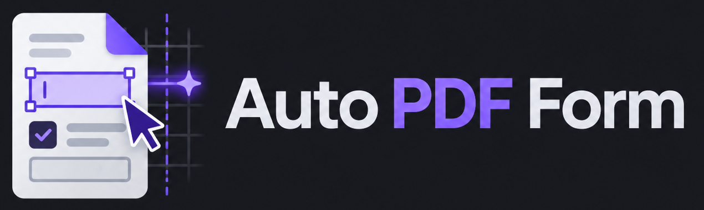

# PDF Form Studio



A local Windows PDF form editor with a dark gray interface, light gray text and purple accents. The Windows builds include Python, Qt and the PDF libraries. No separate Python installation is required to use the executable. The Inno installer also includes Microsoft's signed x64 Visual C++ runtime installer and offers it only when the required runtime is missing.

## Start

- **Fast startup:** install `release/installer/AutoPDFForm-Setup-1.0.0.exe`, or open `release/portable/PDFFormStudio/PDFFormStudio.exe`. Keep its `_internal` folder beside it. The portable build needs the x64 Microsoft Visual C++ v14 runtime, available as `vc_redist.x64.exe` in the GitHub release.
- **Single executable:** open `release/standalone/PDFFormStudio.exe`. This extracts its bundled runtime into a temporary directory when starting, so it starts more slowly than the portable-folder build. It also needs the x64 Microsoft Visual C++ v14 runtime.
- **Python source:** `python main.py`.

You can also drop a PDF or saved `.formstudio.json` project onto the window, or pass its path as a command-line argument.

## Editing a form

1. Open the original or an existing fillable PDF.
2. Select a page in the left column. Search the fields by name and filter by text, dropdown, checkbox or radio category. Select a field in the canvas or list. Drag it to move it; drag a corner to resize it. Position and size are also editable as exact PDF points in the right-hand panel.
3. Set text size, font, left/center/right alignment, character limit, multiple-line entry, text color, background and border. Double-click a field to enter a value. Use the separate **Editor highlight** setting for its outline/selection tint inside this editor.
4. Add text fields, X checkboxes or radio choices. Choices sharing a **Radio group** permit one selected option; each option needs a distinct option value.
5. Use **Filled preview** to inspect a sample-filled export. It does not replace your entered values. Click **Back to editor** to continue.
6. Use **Export PDF** to write a new interactive PDF. The original is preserved. An editable `.formstudio.json` project is saved beside the export. **Save project** also saves your current work without exporting.

PDF background and border colors become part of the saved field appearance. PDF readers control their own temporary blue highlighting; a PDF cannot force every reader to use the editor's selection color.

**Shortcuts:** Ctrl+O opens, Ctrl+S saves a project, Ctrl+Shift+S exports, Ctrl+Z/Ctrl+Y undo/redo, Ctrl+D duplicates, Delete removes a selected field, Ctrl+wheel zooms.

## Automatic mode

**Automatic** analyzes extractable text, underscore baselines, standalone writing rules, blank table cells and printed squares. It can create fields on a blank form, repair existing text/choice positions, align X markers, and split whole dates into day/month/year fields between printed slashes. Recognized yes/no and male/female pairs become exclusive radio groups. Existing group membership is preserved when editing an existing form.

If a blank `Form.pdf` has a sibling `Form_fillable.pdf`, Automatic first verifies the text, text positions, page sizes and page count on every page. It transfers that complete field map only when the artwork matches. **Template…** lets you choose such a matching PDF explicitly. This supports the included school form without hardcoded page numbers or field locations.

The **Analysis report** lists changes and areas needing review. Detection is heuristic: review the page, table fields, choice groups and any unmarked spaces before distributing a form. An altered Word export with different pagination must be detected/reviewed as a new layout; an incompatible template is rejected rather than silently reused.

Scanned/image-only pages need OCR or manual placement. Digital signatures/pushbuttons and rotated/offset pages are blocked for editing/export in this version. Text entry uses standard PDF fonts and supports Latin/Western European text, including German umlauts; values requiring an embedded Unicode font are rejected with an explanation.

## Standalone automation script

Install the Python dependencies with `python -m pip install -r requirements.txt` if you are using the source rather than the executable.

```powershell
python auto_pdf_form.py "C:\Forms\Form.pdf" --preview
python auto_pdf_form.py "C:\Forms\ExistingFillable.pdf" -o "C:\Forms\Corrected.pdf"
python auto_pdf_form.py "C:\Forms\Form.pdf" --analyze-only
python auto_pdf_form.py "C:\Forms\Export.pdf" --template "C:\Forms\MatchingFillable.pdf" --preview
```

The script writes an interactive PDF, an editable project and a JSON report. `--preview` also writes a sample-filled PDF and page PNGs. `--add-missing` discovers additional controls on an existing form. `--no-auto-template` forces generic detection. `--font-size 14` sets the entry size. The source PDF is never overwritten.

## Release downloads

The release folder is grouped by download type:

- `release/installer/AutoPDFForm-Setup-1.0.0.exe` — Inno Setup installer with a Start menu shortcut, optional desktop shortcut and Windows uninstaller.
- `release/portable/AutoPDFForm-Portable-1.0.0.zip` — fast startup; extract the complete folder and keep `_internal` beside the executable.
- `release/standalone/PDFFormStudio.exe` — one-file build that extracts its embedded runtime at launch.
- `vc_redist.x64.exe` — Microsoft's signed x64 Visual C++ runtime installer for portable and single-file builds; the Inno installer already includes it.
- `release/source/AutoPDFForm-Source-1.0.0.zip` — source code, tests, docs and build scripts.
- The GitHub release also includes `qt-everywhere-src-6.11.2.tar.xz` and `pyside-setup-everywhere-src-6.11.2.tar.xz`, with checksums for the bundled LGPL-licensed runtime.

Each release includes a SHA-256 checksum file. The logo comes from the supplied Auto PDF Form artwork. Drag-and-drop, page navigation, field-name search and type filters are built into the editor.

## Build and verify

```powershell
python -m pytest tests -q --basetemp=.test-work
python build.py --mode both
python package_release.py
```

Run the build and packaging commands in a Python environment with `requirements.txt` installed and Inno Setup 6 available. PyInstaller creates the portable folder and the single-file executable, then Inno Setup and `package_release.py` add the installer, source archive, checksum manifest and dependency notices. `requirements.txt` records the dependency versions. Tests also require pytest and reportlab, which are not bundled into the application.

To check a packaged build, run:

```powershell
.\release\PDFFormStudio.exe "C:\Forms\Form.pdf" --self-test ".\validation\package-check.json"
```

This checks the bundled Python/Qt/PDF runtime and exercises PDF reading, rendering, automatic analysis and verified export without opening the editor. The JSON file reports the result.

Exports are reopened to verify canonical field names/values, widget appearances and unchanged page artwork. Source projects are tied to a SHA-256 fingerprint of their original PDF, so editing the original file does not silently misalign a saved project.
